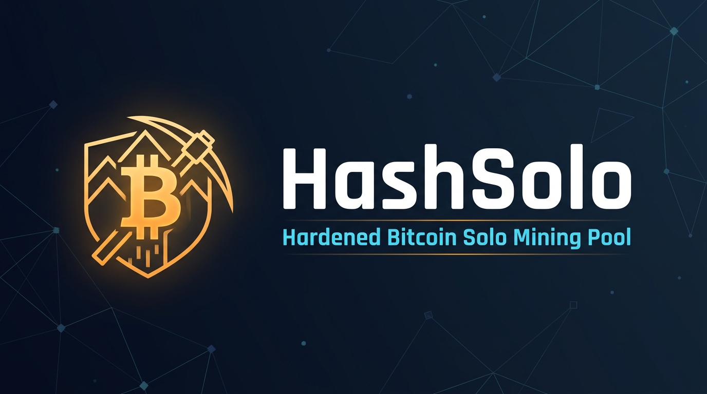
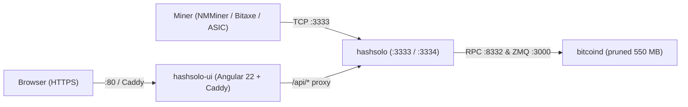

  

  # 🚀 HashSolo Dokploy Compose

  **One-Click Bitcoin Solo Mining Stack for Dokploy (`bitcoind` + `hashsolo` + `hashsolo-ui`)**

  
  
  
  

> [!NOTE]
> **Fork Notice:** This Compose stack deploys the maintained and hardened forks **[gOOvER/hashsolo](https://github.com/gOOvER/hashsolo)** and **[gOOvER/hashsolo-ui](https://github.com/gOOvER/hashsolo-ui)** (based on [`benjamin-wilson/public-pool`](https://github.com/benjamin-wilson/public-pool) and [`benjamin-wilson/public-pool-ui`](https://github.com/benjamin-wilson/public-pool-ui)).

---

## 🏗️ Architecture

- **`bitcoind` (`bitcoin/bitcoin:latest`):** Pruned Bitcoin Core node (`BITCOIN_PRUNE=550` ≈ ~10 GB disk) with RPC & ZMQ (`-printtoconsole=0 -debug=0 -nodebuglogfile`).
- **`hashsolo` (`ghcr.io/goover/hashsolo:latest`):** Stratum V1 server (`3333`) + REST/Prometheus API (`3334`), Telegram bot (`/stats`, `/workers`), and `ntfy` alerts.
- **`hashsolo-ui` (`ghcr.io/goover/hashsolo-ui:latest`):** Angular 22 dashboard with Caddy reverse proxy, Brotli/Gzip compression, live **Bitcoin Node** status card, DE/EN toggle, and Quick Setup tabs.
- All services use `pull_policy: always` so every **Redeploy** in Dokploy pulls the latest images automatically.

---

## ⚡ Setup in Dokploy

1. **Create a Compose Project** in Dokploy pointing to `https://github.com/gOOvER/hashsolo-dokploy`.
2. **Configure Environment Variables** (see [`.env.example`](.env.example)):
   - `BITCOIN_RPC_USER` & `BITCOIN_RPC_PASSWORD` *(strong password — shared by `bitcoind` and `hashsolo`)*
   - `BITCOIN_PRUNE=550` *(~10 GB pruned node; set `0` for full node)*
   - `PUBLIC_POOL_STRATUM_URL=stratum.goover.dev:3333`
   - `DEV_FEE_ADDRESS=` *(optional: 1.5% fee for miners `>= 50 TH/s`; always `0%` under `50 TH/s`)*
   - *Optional KH/s miner tuning (e.g. NMMiner):* `STRATUM_START_DIFF=0.001`, `BEST_DIFF_ALERT_MIN=1`
3. **Add Domain** in Dokploy (**Domains → Add Domain**):
   - **Service:** `hashsolo-ui`, **Port:** `80`, **HTTPS:** Let's Encrypt.
4. **Open Firewall Ports:**
   - **`3333/tcp`**: Stratum V1 for miners *(required)*.
   - **`8333/tcp`**: Bitcoin P2P *(optional, for incoming peers)*.
5. **Persistent Volumes:** `bitcoind-data` (`/home/bitcoin/.bitcoin`) and `hashsolo-db` (`/hashsolo/DB`).

---

## ⛏️ Miner Quick Config (NMMiner / Bitaxe / ASIC)

| Setting | Value |
| :--- | :--- |
| **Pool URL** | `stratum.goover.dev` *(or `stratum+tcp://stratum.goover.dev:3333`)* |
| **Port** | `3333` |
| **Username / Wallet** | `<your-btc-address>.<workername>` *(e.g. `bc1q...xyz.nmminer1`)* |
| **Password** | `x` |

---

## 💝 Support

- **Donate:** [donate.goover.dev](https://donate.goover.dev) · **Ko-fi:** [ko-fi.com/oldnoob](https://ko-fi.com/oldnoob) · **Buy Me a Coffee:** [buymeacoffee.com/goover](https://buymeacoffee.com/goover)
- **Bitcoin (BTC Mainnet):** `bc1qt6wec64n3gnrhclp4vfckyvr8h27tmqswy28gc`
